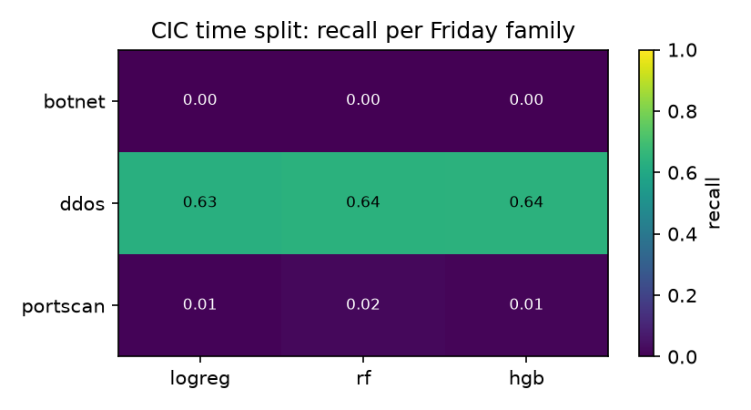

# How Much Does NIDS Evaluation Overestimate Performance? (Interim Update)

EAS 510, Fall 2026, Project 2. Arya Pravin Joshi, Aditya More. Interim update, November 23, 2026.

This is the milestone version of the report. This is for the first half of the project. It will be replaced by the final report on December 7th.

## 1. Question

Papers that present the results of their machine-learning intrusion detection often claim 99%+ detection on CIC-IDS2017, typically given on a random train/test split, with training and test flows being drawn from the same days of the dataset and the same attacks. We assess the score drop when the test is more similar to real use: a later day with attack types not seen by the model (CIC-IDS2017) or the official train/test files (UNSW-NB15). The task is a binary classification of the flow, benign or attack.

## 2. Data

CIC-IDS2017 comes from the Canadian Institute for Cybersecurity, University of New Brunswick (<https://www.unb.ca/cic/datasets/ids-2017.html>), file `MachineLearningCSV.zip` (MD5 `4f83860afbf29cac8163854095bf6cf7`). It was recorded Monday to Friday, 3 to 7 July 2017, with different attacks on different days. One row is one network flow with 78 flow features and a label (14 attack labels, grouped into 8 families).

UNSW-NB15 comes from the UNSW Canberra Cyber Range Lab (<https://research.unsw.edu.au/projects/unsw-nb15-dataset>), files `UNSW_NB15_training-set.csv` and `UNSW_NB15_testing-set.csv`. One row is one network connection record with 42 features and a label (9 attack categories). It has no timestamps.

Both datasets are free for academic research with citation and were retrieved in November 2026. `data/download.py` downloads them and checks the MD5 of every file. `data/clean.py` cleans them:

| Step | CIC-IDS2017 | UNSW-NB15 |
|---|---:|---:|
| Raw rows | 2,830,743 | 257,673 |
| Rows with ±infinity (set to NaN, rows kept) | 2,867 | 0 |
| Exact duplicate rows removed (same features and label) | 308,381 | 94,928 |
| Rows removed because identical features had different labels | 1,396 | 11,506 |
| Clean rows | **2,520,966** | **151,239** |

Missing values are filled with the training median. IP addresses, flow IDs, timestamps and ports are dropped so the models cannot learn identity shortcuts. The models use 76 features on CIC and 42 on UNSW.

Sample. data/sample/ contains 40K CIC flows and 10K UNSW records, created using data/make_sample.py with a fixed seed. Every split and family can be scored on the sample, as rows are stratified by day and label and each row of the rare labels is kept (CIC: Bot, Web Attack Brute Force, XSS, SQL Injection, Infiltration, Heartbleed; UNSW: Shellcode, Analysis, Backdoor, Worms). Sample based AUPRC and recall are not comparable to the full-data numbers, due to the oversampling of rare labels. Per label counts are in data/sample/SAMPLE_README.md.

## 3. Method

**Splits.**

- Random (both datasets): 70/15/15 train/validation/test, stratified by attack family. This is the usual setup in papers and is the comparison for both stricter splits.
- Time (CIC): train Monday to Wednesday (1,527,133 flows), validate Thursday (365,731), test Friday (565,133). Botnet, DDoS and port scan never appear in training.
- Official (UNSW): the authors' training file, with 15% held out (stratified) for validation, against the authors' testing file.

**Models.**

- Logistic regression (baseline): class weighted, signed-log transform and standardization.
- Random forest: class-weighted, no scaling. The most common model in intrusion-detection papers.
- HistGradientBoosting: class weighted, no scaling. Efficient and quick on large tables.

The text columns at UNSW (protocol, service, state) are one-hot encoded. Each run is based on seeds 0, 1 and 2 configured in config.py.

**Metrics.** AUROC, AUPRC and recall at 1% false positive rate (higher is better for all three). Alert threshold is selected on validation to ensure 1% of the benign validation flows will trigger an alert, and remains the same for test. We also include the test FPR at that threshold and recall per attack family. The primary metric is recall at 1% FPR because a security team can only follow up on a limited number of false alarms.

## 4. Progress

Have done and in the repository:

- Download with MD5 checks, cleaning and bundled sample: data/
- See src/splits.py for leakage checking that can be done on random, time and official splits.
- The code has been broken down into three sections: metrics, models, and evaluation (src/metrics.py, src/models.py, src/evaluate.py).
- Single entry point main.py: 36 runs (2 datasets, 2 splits/dataset, 3 models, 3 seeds)
- The tables and figures are made by src/analysis.py and saved in results/sample/ and results/full/.
- Smoke test of synthetic data: tests/smoke_test.py
- A local dashboard including the goal, datasets and result charts and running the commands: dashboard/server.py

## 5. Current results (preliminary)

Full data, mean of 3 seeds, recall at 1% FPR (AUROC in brackets). Higher is better. The data is from [results/full/analysis/main_table.csv](results/full/analysis/main_table.csv) and [results/full/gap_table.csv](results/full/gap_table.csv).

| Split | Logistic regression | Random forest | HistGradientBoosting |
|---|---:|---:|---:|
| CIC random | 0.894 (0.994) | 1.000 (1.000) | 1.000 (1.000) |
| CIC time, test = Friday | 0.373 (0.831) | 0.382 (0.909) | 0.381 (0.922) |
| UNSW random | 0.492 (0.960) | 0.757 (0.981) | 0.754 (0.980) |
| UNSW official split | 0.558 (0.930) | 0.777 (0.964) | 0.807 (0.968) |

*Recall at 1% FPR for each model on the random/ stricter split of each data set, full data*

The tree models perform nearly perfectly on the CIC random split, but reach only about 38% when tested on a later day (Friday). The test FPR also drifts from 1% to 1.7–2.8%. The three models converge fairly close, and the loss occurs from the evaluation and not from one of the models being flaky.

Looking at the time split per family on Friday, all three types of models catch 63–64% of DDoS, 1–2% of port scans, and 0% of botnet flows. The attacks missed are the ones not seen in training.

*Recall per Friday attack family on time split, full data*

On UNSW, the official split does not lower recall (it is higher than on the random split for every model), but AUROC drops slightly for each model, and the threshold chosen on the validation set results in a 2.5–4.5% FPR on the official test file rather than 1%.

The same pattern can be seen in the sample run, which is shown at a smaller scale (e.g. random forest recall: 0.991 at 1% FPR for the CIC random split, 0.232 at 1% FPR for the time split). It verifies the functionality of the pipeline, the results of the full-data runs form the conclusions.

## 6. Challenges

- The official download of CIC-IDS2017 now asks for a registration form. We took a public copy, then downloaded the official file through the form and verified that the MD5 was the same.
- Some validation and test rows were the same as training rows after dropping identifier columns such as ports. We've added an overlap remover, and a check to prevent the run from continuing if there is overlap.
- The cleaning of the entire CIC requires approximately 9 GB of free memory, while the 36 full runs require approximately 25–30 minutes on a laptop CPU. We also added --resume to enable a full run to resume after it is interrupted.
- The validation threshold is not portable to the official test file (FPR 2.5–4.5%) on UNSW. This is reported next to each recall value as test FPR.
- Prior to making the repository public, the dataset terms must be confirmed for sharing the bundled sample.

## 7. Plan for December 7

- Leave-one-attack-family-out splits on both datasets and a benign-only Isolation Forest (Aditya).
- Feature ablation on ports and a check on the corrected CIC-IDS2017 release of Engelen et al. (Arya).
- If time permits, cross-dataset test between CIC & UNSW on shared features (Aditya).
- A small validation set tuning grid for each model (Aditya).
- When the supervised model is uncertain, a fallback to an anomaly score (Aditya).
- Error analysis of why port scans and botnet are not detected (both).
- Final report (2,500–3,500 words), README and fresh-clone test (both).

## 8. Who did what

- **Arya Pravin Joshi:** data download and MD5 checks, cleaning, bundled sample, random splits, time split, official split, leakage controls, metrics, logistic regression baseline, main.py, smoke test, dashboard server.
- **Aditya More:** random forest and HistGradientBoosting runs, analysis tables and figures, dashboard result charts.

## References

1. I. Sharafaldin, A. H. Lashkari, and A. A. Ghorbani, "Toward Generating a New Intrusion Detection Dataset and Intrusion Traffic Characterization," in *Proc. 4th Int. Conf. on Information Systems Security and Privacy (ICISSP)*, 2018, pp. 108–116.
2. N. Moustafa and J. Slay, "UNSW-NB15: A comprehensive data set for network intrusion detection systems (UNSW-NB15 network data set)," in *Proc. Military Communications and Information Systems Conf. (MilCIS)*, 2015.
3. G. Engelen, V. Rimmer, and W. Joosen, "Troubleshooting an Intrusion Detection Dataset: the CICIDS2017 Case Study," in *Proc. IEEE Security and Privacy Workshops (SPW)*, 2021, pp. 7–12.
4. F. Pedregosa et al., "Scikit-learn: Machine Learning in Python," *Journal of Machine Learning Research*, vol. 12, pp. 2825–2830, 2011.
