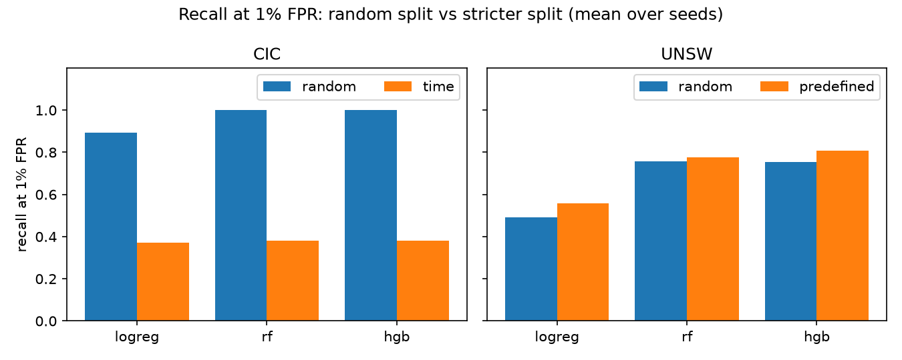

# Generalization Gap in Machine-Learning Network Intrusion Detection: Interim Update

**Arya Pravin Joshi and Aditya More**, University at Buffalo  
EAS 510 Basics of AI, Fall 2026, Project 2  
November 23, 2026  
Repository: <https://github.com/GitNinja4988/Project2_NIDS>

## 1 Research Question, Data and Method

### 1.1 Research Question

In most cases, the detection rates of the published machine-learning intrusion detectors are over 99% in the CIC-IDS2017 under a random split of train/test (shared days and attack campaigns). This project assesses how much of that performance is maintained in deployment-like evaluation: test on a later day that includes attack types not seen in training (CIC-IDS2017 [1]) or on the official held-out data set (UNSW-NB15 [2]). The task is a binary classification problem of network flows – benign or attack.

### 1.2 Data

This is a network flow per observation (78 features in CIC-IDS2017, 42 in UNSW-NB15). Duplicate rows (308,381 in CIC-IDS2017 and 94,928 in UNSW-NB15) and label-conflicting rows (1,396 and 11,506) were removed by cleaning, reducing CIC-IDS2017 from 2,830,743 to 2,520,966 rows and UNSW-NB15 from 257,673 to 151,239 rows. The information on IPs, flow IDs, times and ports was removed so that the models will not be able to remember hosts.

### 1.3 Splits

Every dataset is tested under a random division (70/15/15 with stratification of attack family) and a more stringent division. For CIC-IDS2017, the training is Monday–Wednesday, the validation is Thursday and the testing is Friday; the botnet, DDoS and port-scan traffic is only seen on Friday and therefore not seen during training. The strict division for UNSW-NB15 is the official partition of the authors: the models are trained on their training file, with 15% held out for validation, and tested on their testing file.

### 1.4 Models

Logistic regression is an interpretable baseline model. The comparisons are with the most commonly reported model in this field, random forest, and the powerful tabular learner HistGradientBoosting.

### 1.5 Leakage Safeguards and Metrics

Only training rows are used to fit the preprocessing; validation and test rows that are the same as training rows are removed. Any residual overlap is caught by a leakage check which stops the run. The main measure is recall rate at 1% false positive rate (FPR) because only a few alarms can be investigated by the analysts. The threshold is set on benign validation flows, and AUROC and test FPR are also displayed. Seeds 0, 1 and 2 are used.

## 2 Progress

### 2.1 Data Pipeline

The milestone goal of loaded data, a working pipeline and an evaluated baseline has been attained. Both data sets are downloaded, verified against their MD5 checksums and cleaned (`data/`). Sample is stratified and 50,000 rows are bundled.

### 2.2 Experiments and Code

The splits and leakage checks (`src/splits.py`), metrics (`src/metrics.py`) and models (`src/models.py`) are all built here. The two datasets and the two splits are each evaluated with the three models and the three seeds, with the total of 36 configurations being executed by the evaluation script (`src/evaluate.py`). The single entry point `main.py` runs on the sample in less than one minute, and with `--full` on the full data. All 36 full-data runs are completed. The smoke test and a local dashboard are provided, and the tables and figures in the `results/` folders are created by `src/analysis.py`.

## 3 Current Results (Preliminary)

### 3.1 Main Results

**Table 1.** Recall at 1% FPR (AUROC in parentheses); full data, mean of three seeds; higher is better.

| Dataset / split | Logistic regression | Random forest | HistGradientBoosting |
|---|---:|---:|---:|
| CIC-IDS2017 random | 0.894 (0.994) | 1.000 (1.000) | 1.000 (1.000) |
| CIC-IDS2017 time (test = Friday) | 0.373 (0.831) | 0.382 (0.909) | 0.381 (0.922) |
| UNSW-NB15 random | 0.492 (0.960) | 0.757 (0.981) | 0.754 (0.980) |
| UNSW-NB15 official | 0.558 (0.930) | 0.777 (0.964) | 0.807 (0.968) |

Almost all attacks can be identified by the tree ensembles under the random split, while under the chronological split recall falls to about 0.38. The time split causes the realised test FPR to rise from 1% to 1.7–2.8%. For all three models, recall on Friday is at similar levels (0.373–0.382), which implies that it is not a weak model that is causing the drop, but rather the evaluation.

*Figure 1. Recall at 1% FPR for each model on the random and stricter split of each dataset (full data).*

### 3.2 Per-Family Analysis

The models are able to detect 63–64% of DDoS flows per family. Port-scan and botnet traffic is largely missed: only 1–2% of the port scans and none of the botnet flows are detected. These families were also not seen in training, and the attacks that are missed belong to the families the models do not know how to handle.

*Figure 2. Recall at 1% FPR per Friday attack family on the CIC-IDS2017 time split (full data).*

### 3.3 UNSW-NB15

On UNSW-NB15 the official split does not actually decrease the recall, but rather increases it, and it is higher than under the random split for all models. The AUROC is reduced, and although the threshold is set at 1% FPR on validation, the test FPR rises to 2.5–4.5% instead of 1%.

## 4 Challenges

### 4.1 Resolved

The official CIC-IDS2017 download now requires registration, so a public copy was used and later verified to have the same MD5 checksum as the official file. Removing the port columns made some test rows the same as training rows, and this overlap was solved by per-split removal and a leakage test. Cleaning needs about 9 GB of memory and the full runs take 25–30 minutes, so runs are saved individually so that they can be resumed.

### 4.2 Outstanding

There are two open points not yet resolved: the UNSW-NB15 threshold does not carry over to the official test file (reported as test FPR), and the redistribution terms of the sample should be checked before its public release in the repository.

## 5 Plan for Completion

The next piece of work is due 7th December and as yet undone.

### 5.1 First Priority

A leave-one-attack-family-out evaluation on both data sets, combined with a benign-only Isolation Forest to check if it generalises to unseen families (Aditya More), followed by the report and a fresh-clone test (both).

### 5.2 Second Priority

The second priority is a port-feature ablation and a check of the corrected CIC-IDS2017 release [3] (Arya Pravin Joshi), an error analysis of the missed port-scans and botnets (both) and validation-only tuning (Aditya More).

### 5.3 Lower Priority

The least important are the anomaly-score fallback and the cross-dataset test; the latter will be dropped if time does not allow.

## 6 Individual Contributions

### 6.1 Arya Pravin Joshi

Arya Pravin Joshi was involved with data acquisition and cleaning, the sample, splits and leakage controls, metrics, the logistic regression baseline, the smoke test, `main.py` and the dashboard server.

### 6.2 Aditya More

Aditya More was responsible for the random forest and HistGradientBoosting experiments, analysis tables and figures, and dashboard result charts.

## References

[1] I. Sharafaldin, A. H. Lashkari, A. A. Ghorbani, "Toward Generating a New Intrusion Detection Dataset and Intrusion Traffic Characterization," *Proc. ICISSP*, 2018.  
[2] N. Moustafa, J. Slay, "UNSW-NB15: A comprehensive data set for network intrusion detection systems," *Proc. MilCIS*, 2015.  
[3] G. Engelen, V. Rimmer, W. Joosen, "Troubleshooting an Intrusion Detection Dataset: the CICIDS2017 Case Study," *Proc. IEEE SPW*, 2021.
